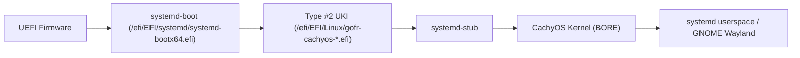

# GOFR Architecture Decision Record & System Design

**Glitchy's Opinionated Fedora Remix (GOFR)** is an x86_64 UEFI Linux distribution based on Fedora Workstation, designed for modern performance, unified kernel image booting, and streamlined terminal workflows.

---

## 1. Core Architecture Principles

1. **Fedora Integrity:**
   - Preserve Fedora Workstation's desktop environment (GNOME Wayland), security profile (SELinux Enforcing), audio stack (PipeWire), and software update mechanisms (DNF5 / RPM).
   - Avoid fork drift: changes are delivered via modular RPM packages (`gofr-*`) rather than unversioned post-install hacks.

2. **Unified Kernel Image (UKI) Centric Boot:**
   - Replace GRUB2 with `systemd-boot` on the installed target.
   - Use unified single-binary EFI executables conforming to Boot Loader Specification (BLS) Type #2 (`/EFI/Linux/<entry>.efi`).
   - UKIs bundle `systemd-stub`, the CachyOS kernel, initramfs, kernel command line, and OS identification.

3. **High-Performance Defaults:**
   - Default running kernel is the optimized [CachyOS Kernel](https://github.com/CachyOS/linux-cachyos) (BORE scheduler, tuned sysctl, advanced CPU optimization).
   - Swap-on-zram with tuned compression algorithms.

4. **Modern Interactive Shell & CLI:**
   - Default user shell is [Brush](https://github.com/reubeno/brush) (Rust-based Bash/POSIX compatible interactive shell).
   - System scripts and DNF transaction scripts continue to execute with GNU `/bin/bash` and `/bin/sh`.
   - Native integration with `zoxide` and `uutils-coreutils` in safe interactive namespaces.

---

## 2. Partitioning & Storage Layout

Default partition scheme for modern UEFI machines:

| Partition | Mount Point | Filesystem | Size | Purpose |
| :--- | :--- | :--- | :--- | :--- |
| **ESP** | `/efi` | FAT32 (`vfat`) | 4 GiB | Holds `systemd-boot`, EFI binaries, and multiple UKI kernel generations |
| **Root** | `/` | Btrfs | Remainder | Subvolume `@` for root system |
| **Home** | `/home` | Btrfs | Remainder | Subvolume `@home` for user data |
| **Swap** | N/A | zram | RAM-scaled | swap-on-zram (default Fedora configuration) |

### Rationale for 4 GiB ESP:
- Standard Fedora ESP partitions are historically 600 MiB–1 GiB.
- Because UKIs contain the entire initramfs and microcode embedded within the kernel PE binary, each UKI is typically 80–130 MiB.
- A 4 GiB ESP ensures ample headroom for:
  - 3–5 rolling CachyOS kernel updates
  - Fallback/rescue kernels
  - Firmware update capsules (`fwupd`)
  - Eliminates the need for a separate `/boot` partition.

---

## 3. Boot Chain

1. **UEFI Firmware** initializes hardware and executes `systemd-boot` from the default or registered EFI boot entry.
2. **systemd-boot** enumerates `/EFI/Linux/*.efi` on the ESP without requiring grub config generation or complex parsing.
3. **systemd-stub** verifies payload integrity, unpacks embedded command-line parameters and initrd, and passes execution to the CachyOS kernel.
4. **Initramfs** discovers root filesystem UUID on Btrfs, mounts subvolume `@`, and pivots to Fedora userspace.

---

## 4. Software Repository Strategy

| Repository | Status | Purpose | GPG Verified |
| :--- | :--- | :--- | :--- |
| `fedora` | Enabled | Upstream base system and GNOME desktop | Yes |
| `updates` | Enabled | Fedora official security & bugfix updates | Yes |
| `bieszczaders:kernel-cachyos` | Enabled | CachyOS kernel packages and dependencies | Yes |
| `rpmfusion-free` | Enabled | Free open-source multimedia & hardware codecs | Yes |
| `rpmfusion-nonfree` | Enabled | Proprietary drivers, firmware, and codecs | Yes |
| `terra` | Enabled | Pre-built modern packages (e.g., `brush-shell`) | Yes |

---

## 5. GOFR Package Suite

GOFR maintains its customizations in 4 distinct packages:

1. **`gofr-release`:**
   - Provides `/etc/os-release` branding (identifies GOFR as a Fedora Remix).
   - Provides repo files for CachyOS COPR, RPM Fusion Free/Nonfree, and Terra.
   - Provides Fedora Remix attribution and licensing notice.

2. **`gofr-defaults`:**
   - Provides user environment profile scripts:
     - Configures default login shell to `/usr/bin/brush` for new users.
     - Sets up `zoxide init` for Brush and Bash.
     - Configures interactive user-space aliases for `uutils` utilities while keeping `/usr/bin/coreutils` standard.
   - Sets sysctl performance tuning (zram, vm swappiness).

3. **`gofr-boot`:**
   - Provides `/efi/loader/loader.conf` defaults.
   - Configures `systemd-boot` as the primary boot target.
   - Provides kernel command line generation templates (`root=UUID=... rw quiet rhgb`).

4. **`gofr-rustyuki-integration`:**
   - Integrates [RustyUKI](https://github.com/GlitchSlayed/RustyUKI) into `kernel-install` events (`/usr/lib/kernel/install.d/90-rustyuki.install`).
   - Configures `/etc/uki/uki.conf` for 4 GiB ESP at `/efi` and CachyOS kernel paths.
