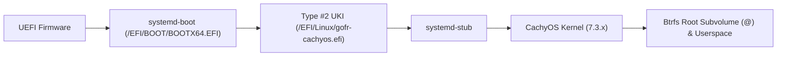

# GOFR Architecture & Design Specification

**Glitchy's Opinionated Fedora Remix (GOFR)** is an x86_64 UEFI Linux distribution based on Fedora Workstation, designed for modern performance, Unified Kernel Image (UKI) booting via `systemd-boot` and RustyUKI, and streamlined terminal workflows.

---

## 1. Architectural Philosophy: Fedora with Opinions

GOFR preserves Fedora Workstation's core integrity:
- **Base:** Fedora Workstation 45 x86_64 with official Fedora repositories.
- **Desktop:** GNOME on Wayland with standard desktop services intact.
- **Audio & Media:** PipeWire & WirePlumber.
- **Security:** SELinux in Enforcing mode.
- **Package Management:** RPM + DNF5.
- **Repositories:** Fedora base, updates, official RPM Fusion Free & Nonfree, and CachyOS COPR.

Customizations are delivered via versioned, modular RPM packages (`gofr-*`) rather than unversioned post-install hacks.

---

## 2. Boot Architecture: UEFI & UKI-Centric

GOFR supports two boot configurations, both utilizing Unified Kernel Images (UKIs) assembled via [RustyUKI](https://github.com/GlitchSlayed/RustyUKI) and `systemd-ukify`:

### 2.1 Default Bootloader: systemd-boot
- Uses **Boot Loader Specification (BLS) Type #2**: UKIs are single PE binaries located under `/EFI/Linux/*.efi`.
- `systemd-boot` scans `/EFI/Linux/` and presents available kernels in its menu automatically.
- Avoids GRUB config generation scripts and grubby modifications.
- Preserves a `.prev.efi` fallback slot for durability.

### 2.2 Optional Backend: Direct UKI
- Boot flow: UEFI firmware executes the UKI directly without an intermediate bootloader.
- Labeled experimental in the installer due to firmware-specific NVRAM behavior.

---

## 3. Storage & Partition Layout

Default GPT partition scheme:

| Partition | Mount Point | Filesystem | Size | Purpose |
| :--- | :--- | :--- | :--- | :--- |
| **ESP** | `/efi` | FAT32 (`vfat`) | 4 GiB | Holds `systemd-boot`, EFI binaries, active UKIs, and fallback slots |
| **Root** | `/` | Btrfs | Remainder | Subvolume `@` for the root system |
| **Home** | `/home` | Btrfs | Remainder | Subvolume `@home` for user data |
| **Swap** | N/A | zram | Scaled | Swap-on-zram (default Fedora configuration) |

The 4 GiB ESP eliminates the need for a separate `/boot` partition and provides headroom for multiple rolling kernel updates, recovery UKIs, and firmware update capsules.

---

## 4. Modern CLI & Interactive Environment

- **Default User Shell:** [Brush](https://github.com/reubeno/brush) registered in `/etc/shells` and configured as the default login shell for newly created users via `useradd -D -s /usr/bin/brush`. System scripts and root retain Bash/POSIX compatibility.
- **Smart Directory Navigation:** [zoxide](https://github.com/ajeetdsouza/zoxide) initialized in user interactive sessions (`/etc/profile.d/gofr-defaults.sh`).
- **Modern Coreutils:** [uutils-coreutils](https://github.com/uutils/coreutils) exposed via safe interactive alias `uu` while preserving standard GNU coreutils for scripts and package managers.
