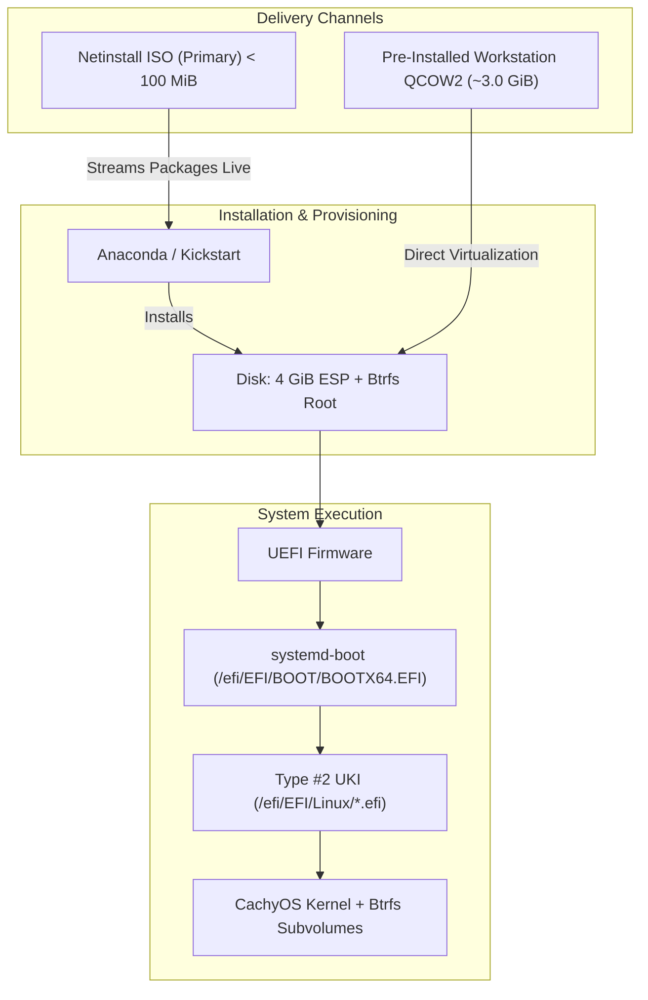

# GOFR Architecture & Design Specification

**Glitchy's Opinionated Fedora Remix (GOFR)** is an x86_64 UEFI Linux distribution based on Fedora Workstation, designed for modern performance, Unified Kernel Image (UKI) booting via `systemd-boot` and RustyUKI, and streamlined developer workflows.

---

## 1. Architectural Philosophy: Fedora with Opinions

GOFR preserves Fedora Workstation's core integrity, stability, and broad compatibility while introducing targeted modernizations:

- **Base Distribution:** Fedora Workstation 45 (`x86_64`) with official Fedora repositories.
- **Desktop Environment:** Full GNOME desktop on Wayland with standard desktop services.
- **Audio & Media:** Low-latency PipeWire & WirePlumber audio/video routing.
- **Security:** SELinux strictly maintained in `Enforcing` mode.
- **Package Management:** Native RPM + DNF5 package transactions.
- **Package Repositories:** Fedora base, updates, official RPM Fusion Free & Nonfree, and CachyOS COPR enabled with OpenPGP verification.

Customizations are delivered via modular, versioned RPM packages (`gofr-*`) rather than unversioned post-install shell hacks.

---

## 2. Delivery Architecture: Dual-Channel Distribution

GOFR supports two primary delivery models tailored for different deployment needs:



### Channel 1: Netinstall ISO (Recommended)
- **Size:** ~84 MiB (< 1 GiB).
- **Benefits:** Rapid download, always up-to-date (installs current packages directly from upstream mirrors), and highly customizable.
- **Use Cases:** Bare-metal desktop installations, customized Kickstart profiles (minimal, Sway, Hyprland, headless servers).

### Channel 2: Pre-Installed Virtual Machine Disk Image
- **Size:** ~3.0 GiB (split into 1800MB chunks `.part00` and `.part01` for GitHub Releases).
- **Benefits:** Instant boot without undergoing an interactive installation.
- **Use Cases:** QEMU/KVM virtual machines, cloud instances, and local testing.

---

## 3. Storage & Partition Layout

GOFR discards legacy partitioning and separate `/boot` partitions in favor of a modern UEFI standard:

| Partition | Mount Point | Filesystem | Default Size | Purpose |
| :--- | :--- | :--- | :--- | :--- |
| **ESP** | `/efi` | FAT32 (`vfat`) | **4 GiB** (4096 MiB) | Houses `systemd-boot`, EFI binaries, active UKIs, fallback slots, and firmware update capsules |
| **Root** | `/` | Btrfs | Remainder | Subvolume `@` containing the root filesystem |
| **Home** | `/home` | Btrfs | Remainder | Subvolume `@home` for persistent user homes and data |
| **Swap** | N/A | zram | Scaled | Dynamic swap-on-zram configured via Fedora defaults |

### Why a 4 GiB ESP at `/efi`?
Standard Linux installations typically allocate 512 MiB to 1 GiB for the ESP. In a pure Unified Kernel Image model, each standalone UKI binary encapsulates the kernel, full Dracut initramfs, CPU microcode, and boot splash (typically 80–120 MiB per kernel version). A 4 GiB ESP guarantees sufficient headroom for:
- Multiple rolling CachyOS kernel generations.
- Automatic fallback slots (`.prev.efi`).
- Recovery environments and diagnostic UKIs.
- UEFI firmware updates via `fwupd` without risk of out-of-space bootloader corruption.

---

## 4. Boot Architecture: UEFI & UKI-Centric

GOFR uses **Boot Loader Specification (BLS) Type #2**:

```
[ UEFI Firmware ]
       │
       ▼
[ /efi (4 GiB FAT32 ESP) ]
       ├── EFI/BOOT/BOOTX64.EFI          (systemd-boot binary)
       ├── loader/loader.conf            (timeout, entry configuration)
       └── EFI/Linux/                    (BLS Type #2 UKI binaries)
             ├── gofr-cachyos.efi        (Active CachyOS UKI)
             └── gofr-cachyos.prev.efi   (Preserved fallback slot)
       │
       ▼
[ Btrfs Root Filesystem ]
       ├── Subvolume @                   (Mounted at /)
       └── Subvolume @home               (Mounted at /home)
```

- **Bootloader:** `systemd-boot` natively scans `/efi/EFI/Linux/` and presents discovered `.efi` binaries in the boot menu.
- **UKI Builder:** [RustyUKI](https://github.com/GlitchSlayed/RustyUKI) and `systemd-ukify` compile the PE binary.
- **Rollback Durability:** During kernel updates, the prior operational UKI is preserved as `.prev.efi`. If an updated kernel fails to boot, users can select the previous kernel from the `systemd-boot` menu.

---

## 5. Performance Kernel Subsystem

- **Kernel:** [CachyOS Linux Kernel](https://github.com/CachyOS/linux-cachyos) (`kernel-cachyos`).
- **Features:**
  - BORE (Burst-Oriented Response Enhancer) CPU scheduler for optimal interactive desktop latency.
  - Performance-tuned compiler optimizations (x86-64-v3 instructions).
  - Modern filesystem optimizations for Btrfs, NVMe, and memory subsystems.
- **Source:** Verified Fedora COPR (`bieszczaders/kernel-cachyos`).

---

## 6. Shell & Modern CLI Stack

- **Default User Login Shell:** [Brush](https://github.com/reubeno/brush) registered in `/etc/shells` and set as the default shell for new user accounts via `useradd -D -s /usr/bin/brush`. Root and system service scripts retain full POSIX / Bash compatibility.
- **Cross-Shell Prompt:** [Starship](https://starship.rs) initialized automatically for Brush and interactive shells (`/etc/profile.d/gofr-defaults.sh` and skeleton config `/etc/skel/.config/brush/brushrc`).
- **Smart Directory Navigation:** [zoxide](https://github.com/ajeetdsouza/zoxide) initialized in user interactive sessions (`/etc/profile.d/gofr-defaults.sh`).
- **Modern User Space Tools:** [uutils-coreutils](https://github.com/uutils/coreutils) exposed via safe interactive alias `uu` while preserving GNU coreutils for script execution.
- **Modern Terminal Utilities:** Pre-installed [starship](https://starship.rs), [ripgrep](https://github.com/BurntSushi/ripgrep), [fd-find](https://github.com/sharkdp/fd), [bat](https://github.com/sharkdp/bat), [eza](https://github.com/eza-community/eza), and [btop](https://github.com/aristocratos/btop).
