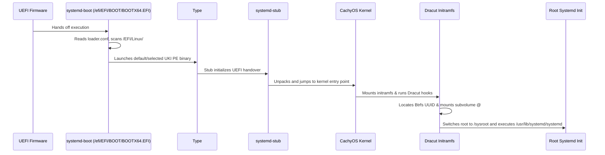

# Boot Architecture & UKI Specification

GOFR boots exclusively via UEFI using Unified Kernel Images (UKIs) assembled according to the Boot Loader Specification (BLS). This document specifies the boot chain, supported backends (`systemd-boot` and `direct`), runtime lifecycle hooks, and dual-target boot environments (Netinstall ISO vs. Installed System).

---

## 1. Boot Loader Backends

GOFR supports two UEFI boot mechanisms managed by [RustyUKI](https://github.com/GlitchSlayed/RustyUKI):

| Backend | Primary Use Case | Entry Discovery | Fallback Mechanism |
| :--- | :--- | :--- | :--- |
| **`systemd-boot` (Default)** | General Workstation & ISO install | BLS Type #2 (`$ESP/EFI/Linux/`) | Interactive menu & `.prev.efi` slots |
| **`direct` (Direct UKI)** | Minimal / Ultra-fast boot | UEFI NVRAM (`efibootmgr`) | One-shot `BootNext` + promotion |

### 1.1 systemd-boot (BLS Type #2)
- UKIs are standalone UEFI PE binaries located at:
  ```
  $ESP/EFI/Linux/<ENTRY_TOKEN>-<KERNEL_VERSION>.efi
  ```
- Example:
  ```
  /efi/EFI/Linux/gofr-7.3.3-1.cachyos1.fc45.x86_64.efi
  /efi/EFI/Linux/gofr-7.3.3-1.cachyos1.fc45.x86_64.prev.efi
  ```
- `systemd-boot` automatically discovers all `.efi` binaries in `$ESP/EFI/Linux/` and presents them in the boot menu without requiring NVRAM entry manipulation.

### 1.2 Direct UKI (UEFI NVRAM Direct Boot)
- UEFI firmware loads the UKI binary directly from `$ESP/EFI/Linux/<name>.efi`.
- `efibootmgr` manages entries in UEFI NVRAM:
  - New kernels are registered as trial boot candidates using `BootNext`.
  - Once userland reaches `rustyuki-boot-confirm.service`, `rustyuki confirm` permanently shifts `BootCurrent` to the top of `BootOrder`.
  - If a newly installed kernel faults, a reboot without intervention causes firmware to revert to the previous `BootOrder` entry.

### 1.3 Graphical Backend Selection (`gofr-welcome`)
- In live installer environments, GOFR provides `gofr-welcome`, a dedicated Libadwaita onboarding application.
- It displays a welcome summary of the system architecture and features an interactive UKI boot backend selection page.
- The selected backend is recorded to `/tmp/gofr-boot-backend`, transferred by Kickstart (`%post --nochroot`), and applied automatically to `/etc/rustyuki/config.toml` before initial UKI reconciliation.

---

## 2. Loader Configuration (`loader.conf`)

When using the `systemd-boot` backend, configuration is located at `$ESP/loader/loader.conf`:

```ini
default gofr*
timeout 3
console-mode max
auto-entries 1
auto-firmware 1
reboot-for-bitlocker 0
```

- `default gofr*`: Boots the newest matching entry by default.
- `timeout 3`: Gives the user a 3-second window to enter the boot menu or select fallback entries.
- `auto-entries 1`: Automatically detects EFI/Linux Type #2 images and Windows Boot Manager if dual-booting.

---

## 3. UKI Anatomy

Each generated UKI binary contains the following PE sections assembled via `systemd-ukify`:

| Section Name | Content | Description |
| :--- | :--- | :--- |
| `.text` / `.data` | `systemd-stub` | UEFI stub loader executable |
| `.linux` | `vmlinuz` | CachyOS kernel binary |
| `.initrd` | `initramfs.img` | Dracut generated initramfs + CPU microcode |
| `.cmdline` | Kernel parameters | `root=UUID=<UUID> rootflags=subvol=@ ro quiet rhgb console=tty0 console=ttyS0` |
| `.osrel` | `/usr/lib/os-release` | OS metadata identifying GOFR (passed via `@/usr/lib/os-release`) |
| `.splash` | Optional bitmap | Boot splash graphic |

---

## 4. Boot Environments

### 4.1 Installed System Boot Sequence


### 4.2 Netinstall Hybrid ISO Boot Sequence
The Netinstall ISO (`gofr-netinstall-*.iso`) provides an El Torito hybrid UEFI boot structure:
- UEFI firmware boots `EFI/BOOT/BOOTX64.EFI` from the embedded EFI system partition.
- `systemd-boot` presents the installation options:
  - **GOFR 45 Netinstall (GNOME Workstation) [Default]**
  - **GOFR 45 Netinstall (Sway Wayland Desktop)**
  - **GOFR 45 Netinstall (Minimal Developer)**
  - **GOFR 45 Netinstall (Interactive Anaconda)**
  - **Reboot into Firmware Interface**
- The installer kernel loads an initramfs with network provisioning and loads package groups directly from upstream mirrors into target disks.

---

## 5. Kernel Lifecycle Flow & Fallback Retention

When a kernel package is installed or updated via DNF5:

1. `dnf5 upgrade kernel-cachyos` downloads and unpacks RPM files into `/usr/lib/modules/<version>/`.
2. DNF5 triggers `/usr/bin/kernel-install add <version> /usr/lib/modules/<version>/vmlinuz`.
3. `kernel-install` invokes plugin `/usr/lib/kernel/install.d/90-rustyuki.install`.
4. RustyUKI reads `/etc/rustyuki/config.toml`, invokes `dracut` to generate the initrd, and `ukify build` to output the new `.efi` directly into `/efi/EFI/Linux/`.
5. The prior working UKI is automatically retained as `.prev.efi`. If the newly installed kernel encounters a fault:
   - Under `systemd-boot`: Users simply reboot and select the previous kernel from the boot menu.
   - Under `direct`: The system automatically falls back if `rustyuki confirm` was not executed.
