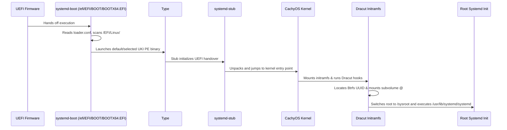

# Boot Architecture & UKI Specification

GOFR boots exclusively via UEFI using `systemd-boot` and Unified Kernel Images (UKIs). This document specifies the boot chain, configuration conventions, runtime lifecycle hooks, and dual-target boot environments (Netinstall ISO vs. Installed System).

---

## 1. Boot Loader Specification (BLS) Type #2

Unlike legacy GRUB configurations or BLS Type #1 (which use separate kernel, initramfs, and `.conf` snippets under `/boot/loader/entries/`), GOFR standardizes on **BLS Type #2**:

- UKIs are single UEFI PE binaries located at:
  ```
  $ESP/EFI/Linux/<ENTRY_TOKEN>-<KERNEL_VERSION>.efi
  ```
- Example:
  ```
  /efi/EFI/Linux/gofr-7.3.1-1.cachyos1.fc45.x86_64.efi
  /efi/EFI/Linux/gofr-7.3.1-1.cachyos1.fc45.x86_64.prev.efi
  ```
- `systemd-boot` automatically discovers all `.efi` binaries in `$ESP/EFI/Linux/` and presents them in the boot menu ordered chronologically/version-wise without requiring NVRAM entry manipulation.

---

## 2. Loader Configuration (`loader.conf`)

Located at `$ESP/loader/loader.conf`:

```ini
default gofr*
timeout 3
console-mode max
auto-entries 1
auto-firmware 1
reboot-for-bitlocker 0
```

- `default gofr*`: Boots the newest matching entry by default.
- `timeout 3`: Gives the user a 3-second window to enter the boot menu or select fallback entries.
- `auto-entries 1`: Automatically detects EFI/Linux Type #2 images and Windows Boot Manager if dual-booting.

---

## 3. UKI Anatomy

Each generated UKI binary contains the following PE sections assembled via `systemd-ukify`:

| Section Name | Content | Description |
| :--- | :--- | :--- |
| `.text` / `.data` | `systemd-stub` | UEFI stub loader executable |
| `.linux` | `vmlinuz` | CachyOS kernel binary |
| `.initrd` | `initramfs.img` | Dracut generated initramfs + CPU microcode |
| `.cmdline` | Kernel parameters | `root=UUID=<UUID> rootflags=subvol=@ ro quiet rhgb` |
| `.osrel` | `/etc/os-release` | OS metadata identifying GOFR |
| `.splash` | Optional bitmap | Boot splash graphic |

---

## 4. Boot Environments

### 4.1 Installed System Boot Sequence


### 4.2 Netinstall Hybrid ISO Boot Sequence
The Netinstall ISO (`gofr-netinstall-*.iso`) provides an El Torito hybrid UEFI boot structure:
- UEFI firmware boots `EFI/BOOT/BOOTX64.EFI` from the embedded EFI system partition.
- `systemd-boot` presents the installation options:
  - **GOFR 45 Netinstall (GNOME Workstation) [Default]**
  - **GOFR 45 Netinstall (Sway Wayland Desktop)**
  - **GOFR 45 Netinstall (Minimal Developer)**
  - **GOFR 45 Netinstall (Interactive Anaconda)**
  - **Reboot into Firmware Interface**
- The installer kernel loads an initramfs with network provisioning and loads package groups directly from upstream mirrors into target disks.

---

## 5. Kernel Lifecycle Flow & Fallback Retention

When a kernel package is installed or updated via DNF5:

1. `dnf5 upgrade kernel-cachyos` downloads and unpacks RPM files into `/usr/lib/modules/<version>/`.
2. DNF5 triggers `/usr/bin/kernel-install add <version> /usr/lib/modules/<version>/vmlinuz`.
3. `kernel-install` invokes plugin `/usr/lib/kernel/install.d/90-rustyuki.install`.
4. RustyUKI reads `/etc/rustyuki/config.toml`, invokes `dracut` to generate the initrd, and `ukify build` to output the new `.efi` directly into `/efi/EFI/Linux/`.
5. The prior working UKI is automatically retained as `.prev.efi`. If the newly installed kernel encounters a fault, users simply reboot and select the previous kernel from the `systemd-boot` menu.
