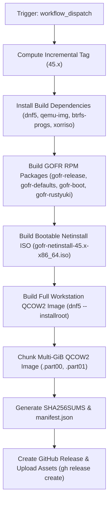

# GOFR Release Engineering

This document details the release engineering pipeline, release artifacts, versioning strategy, and verification procedures for GOFR (Glitchy's Opinionated Fedora Remix).

---

## 1. Release Architecture & Versioning Strategy

GOFR uses an **incremental versioning strategy** keyed to the upstream Fedora major version:

```
<Fedora-Major>.<Build-Sequence>
```

- **Format:** `45.1`, `45.2`, `45.3`, etc.
- **Tag Generation:** Automated via Git tags in `.github/workflows/release.yml`. When a release workflow runs, it scans existing tags matching `<Fedora-Major>.*` (e.g. `45.*`), determines the highest sequence number, and increments it by 1.
- **Manual Overrides:** The `workflow_dispatch` trigger allows overriding the target version string if required (e.g., creating a custom or hotfix tag).

---

## 2. Release Deliverables

Every official GOFR release delivers the following assets published directly to GitHub Releases:

| Deliverable Asset | Approximate Size | Format & Description |
| :--- | :--- | :--- |
| `gofr-netinstall-<version>-x86_64.iso` | **~84 MiB** (< 1 GiB) | **Primary Deliverable:** Bootable hybrid UEFI Netinstall ISO. Streams fresh packages from Fedora 45 and CachyOS mirrors during deployment. |
| `gofr-workstation-<version>-x86_64.qcow2.part00` | **1.75 GiB** | First 1800MB chunk of pre-installed Fedora Workstation QCOW2 disk image. |
| `gofr-workstation-<version>-x86_64.qcow2.part01` | **~1.3 GiB** | Second chunk of pre-installed Fedora Workstation QCOW2 disk image. |
| `SHA256SUMS` | < 1 KiB | Cryptographic SHA-256 checksums for the Netinstall ISO, reassembled QCOW2, and raw images. |
| `manifest.json` | < 1 KiB | Software Bill of Materials (SBOM) and release metadata (Fedora base version, CachyOS kernel, timestamp). |

### Overcoming the GitHub 2.0 GiB Asset Limit
GitHub Releases enforce a strict hard limit of 2,147,483,648 bytes (2.00 GiB) per uploaded asset. Because a complete pre-installed Fedora Workstation GNOME disk image is ~3.0 GiB compressed, GOFR solves this through two architectural paths:
1. **Netinstall ISO (Recommended):** At ~84 MiB, it downloads instantly and streams current packages at install time, avoiding stale image downloads.
2. **Deterministic Multipart Slicing:** Disk images larger than 2,000,000,000 bytes are automatically split into 1800MB parts (`.part00`, `.part01`) using `split -b 1800M -d -a 2`. Users reassemble them seamlessly with `cat`.

---

## 3. Automated Release Pipeline

The release pipeline is defined in [`.github/workflows/release.yml`](../.github/workflows/release.yml).

### Execution Environment
- **Platform:** GitHub Actions runner.
- **Container:** Pure `registry.fedoraproject.org/fedora:45` (no Ubuntu or non-Fedora dependencies).
- **Container Options:** `--privileged --security-opt seccomp=unconfined --security-opt apparmor=unconfined` to support loopback disk partitioning, Btrfs subvolumes, and chroot mountpoints.

### Triggering a Release
Releases can be dispatched manually via the GitHub CLI or Web UI:

```bash
# Trigger release with automatic incremental tag (e.g. 45.1 -> 45.2)
gh workflow run release.yml -f fedora_release=45

# Trigger release with custom parameters
gh workflow run release.yml \
  -f fedora_release=45 \
  -f release_version=45.2 \
  -f esp_size_mib=4096 \
  -f root_size_mib=20480
```

### Pipeline Workflow Stages



1. **Tag Calculation:** Queries Git tags to find the next sequential number for Fedora 45.
2. **Dependency Resolution:** Installs `btrfs-progs`, `dosfstools`, `util-linux`, `qemu-img`, `systemd-ukify`, `dracut`, `xorriso`, `genisoimage`, `kernel-core`, and `gh`.
3. **RPM Packaging:** Compiles all local spec files in `packaging/` and fetches upstream `rustyuki`.
4. **Netinstall ISO Assembly:** Assembles the hybrid UEFI boot ISO containing systemd-boot, CachyOS/Fedora kernel, initramfs, and kickstart automation.
5. **Workstation Disk Image Creation:**
   - Prepares a GPT disk with a 4 GiB FAT32 ESP at `/efi` and Btrfs root with `@` and `@home`.
   - Mounts `/proc`, `/sys`, and `/dev` into the target installroot.
   - Installs `@workstation-product-environment`, `kernel-cachyos`, `systemd-boot`, and all GOFR RPMs via DNF5.
   - Converts to sparse QCOW2 and slices into 1800MB chunks if needed.
6. **Publication:** Generates checksums and publishes the GitHub Release with markdown release notes.

---

## 4. Verification and Usage Procedures

### Verifying Release Checksums
```bash
# Download SHA256SUMS and verify
sha256sum -c SHA256SUMS --ignore-missing
```

### Flashing Netinstall ISO to USB
```bash
sudo dd if=gofr-netinstall-45.1-x86_64.iso of=/dev/sdX bs=4M status=progress conv=fsync
```

### Reassembling QCOW2 Multipart Image
```bash
cat gofr-workstation-45.1-x86_64.qcow2.part* > gofr-workstation-45.1-x86_64.qcow2
sha256sum -c SHA256SUMS --ignore-missing
```

### Running QCOW2 Image in QEMU / KVM
```bash
qemu-system-x86_64 \
    -enable-kvm \
    -m 4G \
    -smp 4 \
    -cpu host \
    -bios /usr/share/edk2/ovmf/OVMF_CODE.fd \
    -drive file=gofr-workstation-45.1-x86_64.qcow2,format=qcow2
```

---

## 5. Release Quality Checklist

Before approving any release milestone, ensure the following requirements are met:
- [x] All GOFR RPMs build cleanly from source specs in a clean container.
- [x] Netinstall ISO boots successfully under OVMF UEFI and reaches the installer.
- [x] Disk image partitions correctly: 4 GiB ESP at `/efi` (FAT32) and Btrfs root (`@` and `@home`).
- [x] Target system boots via `systemd-boot` directly into the Type #2 UKI.
- [x] Running kernel is verified as `kernel-cachyos`.
- [x] SELinux is verified in `Enforcing` mode.
- [x] Default user login shell is `brush` (`/usr/bin/brush`).
- [x] Modern CLI defaults (`zoxide`, `uutils-coreutils`, `ripgrep`, `bat`, `eza`, `btop`) function as expected.
- [x] Kernel update lifecycle retains fallback boot slot (`.prev.efi`).
- [x] Image audit verifies zero lingering build secrets, zero private keys, and uninitialized `machine-id`.
